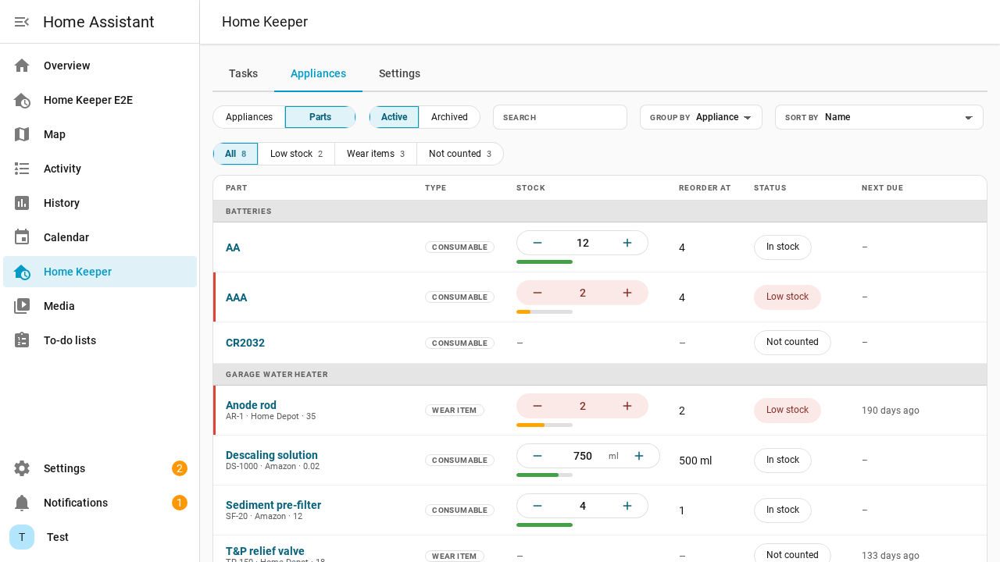
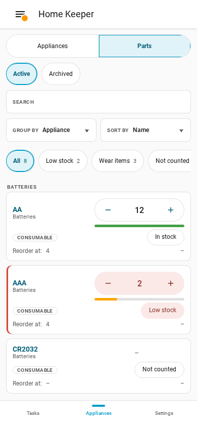
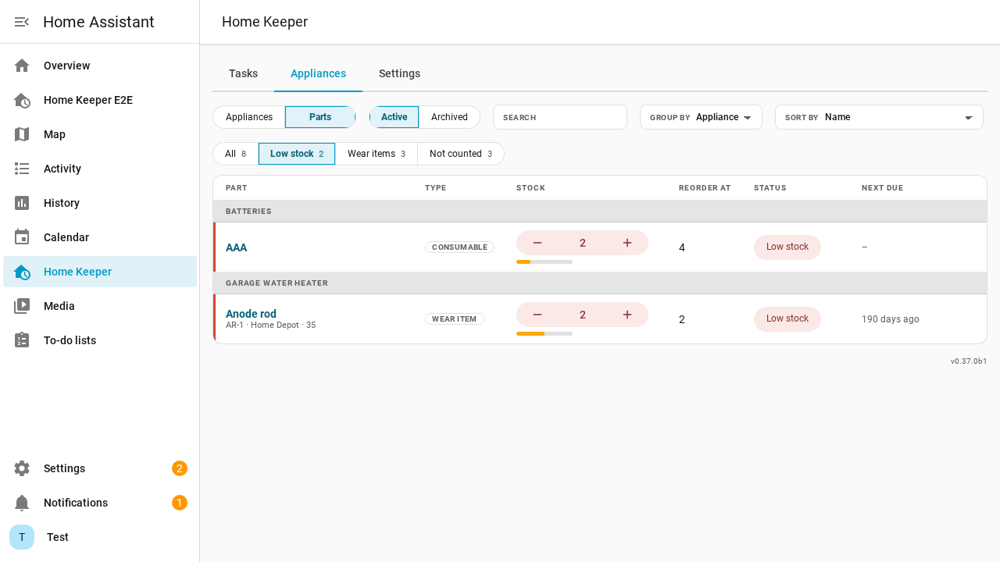
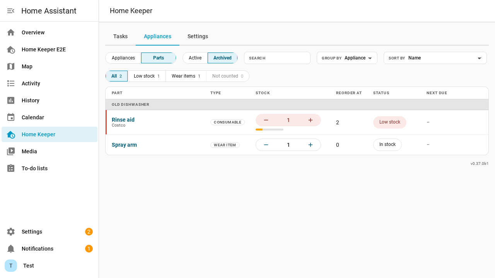
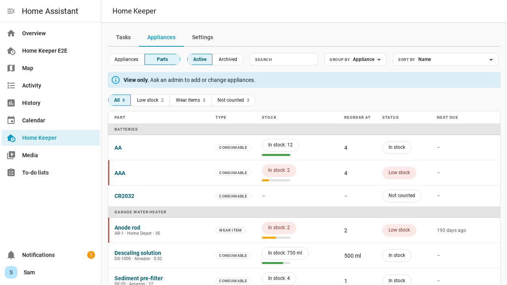

# Parts overview

The **Parts** view lists every part of every appliance in 1 place. It shows the low
parts and the parts that wear out. A user does not need to open each appliance.

The view is a mode of the **Appliances** tab. It reads the same data as the **Parts** tab
of an appliance page. It does not change any service, event or setting.

## Open the Parts view

1. Open the **Appliances** tab.
2. Select **Parts** in the **Appliances** | **Parts** switch.

The address of the view is `/home-keeper/appliances/parts`. Select **Appliances** to go
back to the list of appliances. The panel keeps the last mode in this browser. The
**Appliances** tab opens in that mode.

## Read a row

| Column | Content |
|---|---|
| Part | Name, part number, vendor and cost. The name links to the part on its appliance page. |
| Type | **consumable** or **wear item**. |
| Stock | The stock stepper. It has the same controls as the **Parts** tab of an appliance page. |
| Reorder at | The stock level at which the part is low. |
| Status | **Low stock**, **In stock** or **Not counted** |
| Next due | The due date of the task that replaces a wear item, or the use count of a counted wear item. |

A part is low when its stock is at or below its reorder point. A part with no stock
number has the status **Not counted**, and is never low.

If a low part has a Buy task, the **Status** column has a **Buy** link. The link opens
the Buy task. A low part with no Buy task has no link.

Each tap on **−** or **+** is 1 stock change. The change is the same one that the
appliance page makes. It can create or end a Buy task, as on the appliance page.

## Find parts

The chips above the list filter the parts. Each chip shows a count.

- **All** shows every part.
- **Low stock** shows the low parts.
- **Wear items** shows the parts of type wear item.
- **Not counted** shows the parts with no stock number.

The counts follow the **Search** box and the scope. They do not follow the chip.

Use these controls to arrange the list:

- **Search** matches the name, the part number, the vendor and the name of the appliance.
- **Group by** is **Appliance** or **Type**. The default is **Appliance**.
- **Sort by** is **Name**, **Stock** or **Last replaced**.

**Stock** puts the lowest stock first and the parts with no count last. **Last replaced**
puts the oldest date first and the parts that were never replaced last.

The panel keeps the chip, the group and the sort in this browser. They are not a setting
of the user.

## Archived appliances

The view hides the parts of archived appliances. Select **Archived** in the scope to show
them. Select **Active** to go back.

## Appliances that an integration owns

The parts of an appliance that an integration owns show in the view. An example is the
battery pool. An admin can change the stock of these parts. The integration locks the name
of the appliance.

## Users who are not admins

Only an admin can change stock. A user who is not an admin sees the same list. The
stock is text, and the list has no stepper. The backend refuses a stock change from a user
who is not an admin.

## Add a part

The Parts view has no **Add part** button. A part belongs to an appliance. To add a part,
open the appliance, open its **Parts** tab, and select **Add part**. See
[Parts and wear items](appliances.md#parts--wear-items).
