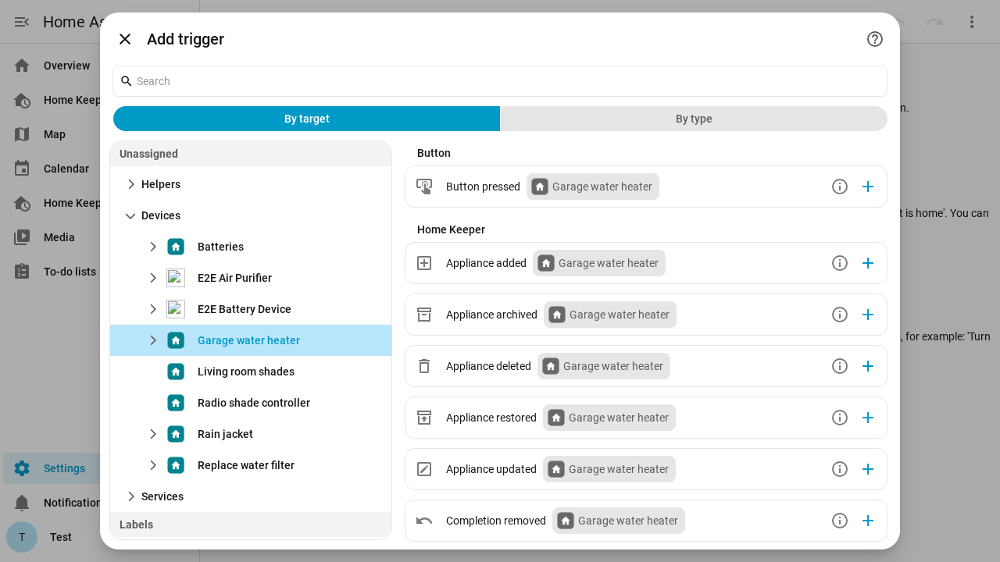
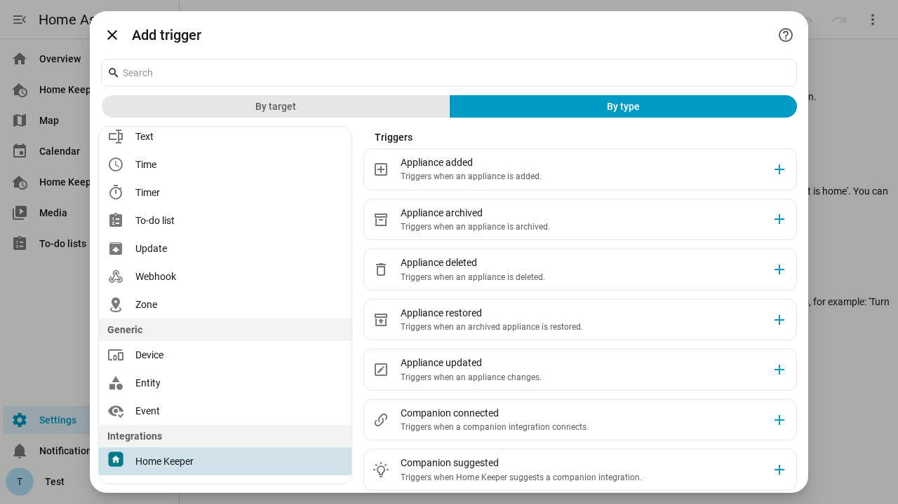
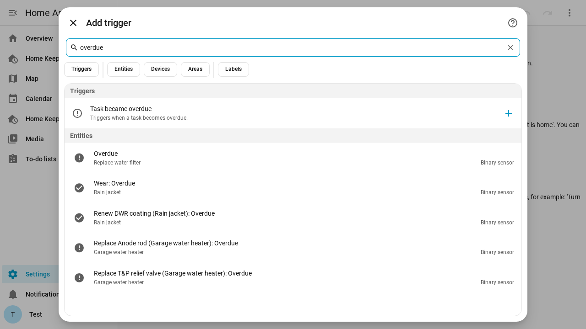
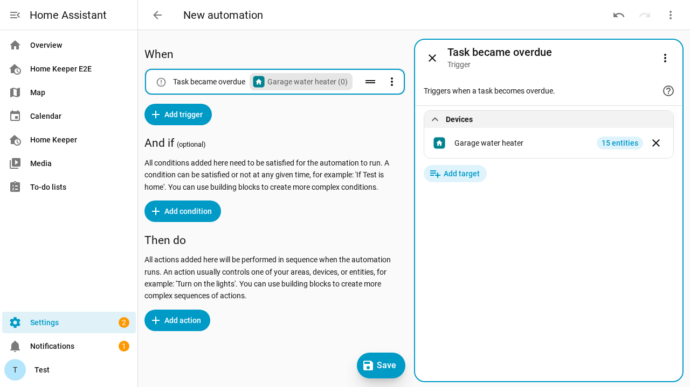
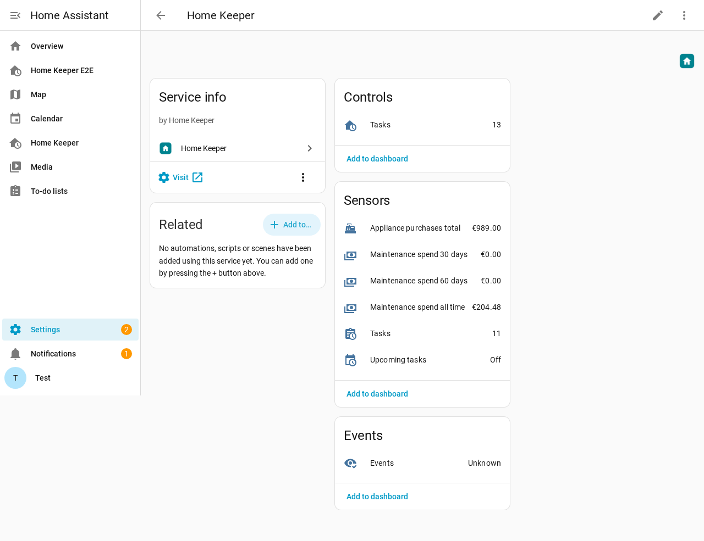
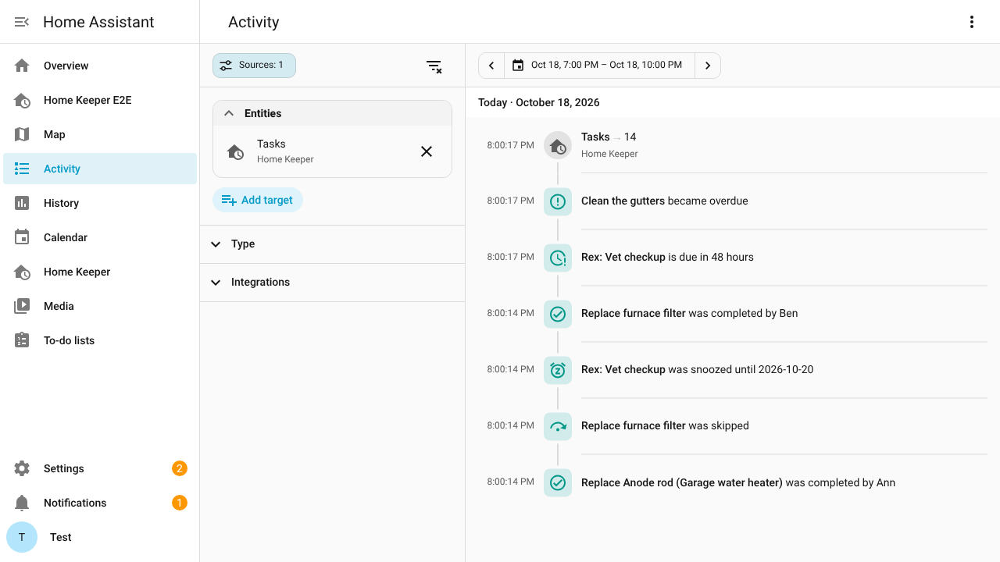
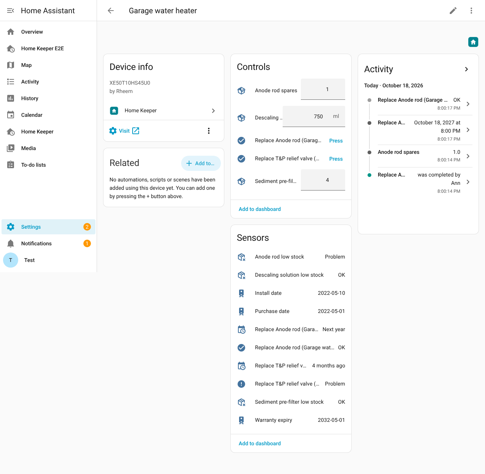

# Events & automations

Home Keeper fires a Home Assistant bus event for every state change. Use these
events to build automations. The events are:

| Object | Events |
| --- | --- |
| Task | created, updated, completed, uncompleted, completion edited, deleted, armed, snoozed, due today set, skipped, overdue, due soon |
| Part | low stock, out of stock, restocked |
| Appliance | created, updated, deleted, archived, restored |
| Companion | connected, suggested |

There are 3 ways to trigger on an event:

- Select a Home Keeper trigger in the automation editor, such as **Task became
  overdue** or **Spare part out of stock**. See [Triggers](#triggers) below.
- Use the **Event received** trigger on the Home Keeper **Events** entity. See
  [Events entity](#events-entity) below.
- Use a plain `platform: event` trigger on the event name.

## Triggers

Home Keeper adds 1 trigger for each of its events to the automation editor. The
triggers work on Home Assistant 2026.1 and later. In **Add trigger**, find them in
3 places:

- **By target**: select a device, an area or a label. The **Home Keeper** group
  lists the triggers for it.
- **By type**: select **Home Keeper** under **Integrations**.
- **Search**: type a word of the trigger name, such as `overdue`.







### Target

A task, part or appliance trigger needs a target. The target selects the tasks,
parts and appliances that fire the trigger:

| Target | The trigger fires for |
| --- | --- |
| Entity | The task, part or appliance of the Home Keeper entity |
| Device | The tasks, parts and appliances on the device |
| Area | The tasks and devices in the area, and each task with that area |
| Floor | The areas on the floor |
| Label | The tasks with the label, and the entities, devices and areas with it |
| Home Keeper device | All tasks, parts and appliances |

A task with no device has no entities. Target it by its area or its label, or select
the Home Keeper device or the Home Keeper to-do list. The triggers for companions,
declarative companions, data export and data import have no target.



Home Keeper reads the target when the event fires. If a task moves to another device,
the trigger follows the task. If you remove a device or a task, the trigger stops for
it. The count next to the target in the trigger row can show 0. The trigger still
fires for the tasks on that target.

The trigger variables hold the event as `trigger.event`, the same as a
`platform: event` trigger. In YAML:

```yaml
automation:
  - alias: "Garage task overdue"
    triggers:
      - trigger: home_keeper.task_overdue
        target:
          area_id: garage
    actions:
      - action: notify.notify
        data:
          message: "Overdue: {{ trigger.event.data.name }}"
```

The trigger name is the event name without `home_keeper_`, such as
`home_keeper.task_completed` or `home_keeper.part_low_stock`.

### Device triggers

The device triggers on a Home Keeper appliance and on a task device still work. Use
the Home Keeper triggers for a new automation. In Home Assistant 2026.7 and later,
**Add trigger** shows the device triggers under **By type**, **Device**. Home
Assistant offers device triggers only for the 1 integration a device belongs to.

## Events entity

Home Keeper adds 1 **Events** entity, `event.home_keeper_events`, on the Home Keeper
device. It gets all events, also for a task that has no device. The logbook and the
history of the entity show each event.



Use it with the **Event received** trigger to get more than 1 event type from 1
trigger. The **Event received** trigger needs Home Assistant 2026.7 or later. In
Home Assistant 2026.6, it is a Labs preview. In YAML:

```yaml
automation:
  - alias: "Any task done"
    triggers:
      - trigger: event.received
        target:
          entity_id: event.home_keeper_events
        options:
          event_type: [task_completed, task_skipped]
    actions:
      - action: notify.notify
        data:
          message: "{{ trigger.to_state.attributes.name }}"
```

The event type is the event name without `home_keeper_`. The attributes are the event
data, without the large fields (`source`, `managed_by`, `task_chips`, `active_season`,
`note`, `photo` and `sections`). Add a condition on the `task_id` attribute to select
1 task.

If an event fires while Home Keeper reloads, the Events entity can miss it. Adding a
task to a device starts a reload. The Home Keeper triggers read each event from the
bus, so they get every event.

An automation can add a part to the shopping list when the part goes out of stock.
This is useful for a part without
[Auto-create buy task](../appliances/appliances.md#auto-create-a-buy-task-when-a-part-runs-low):

```yaml
automation:
  - alias: "Spare out of stock → shopping list"
    trigger:
      - platform: event
        event_type: home_keeper_part_out_of_stock
    action:
      - service: todo.add_item
        target: { entity_id: todo.shopping_list }
        data:
          item: "{{ trigger.event.data.part_name }} ({{ trigger.event.data.vendor }})"
```

The built-in [shopping-list sync](../appliances/appliances.md#send-buy-reminders-to-your-shopping-list) does
this for a part already on auto-buy, and removes the line again when the part is
restocked.

Events are edge-triggered. Home Keeper fires 1 event per transition and does not
repeat it each cycle. Events are baselined on restart, so no overdue events are
fired after a reboot. The full catalog with every event and payload is in
[docs/EVENTS.md](../../EVENTS.md).

## Task history in the logbook

Home Keeper writes a logbook row for each of these task events:

| Event | Row |
| --- | --- |
| Completed | was completed by Ann |
| Completed by a sensor | was completed by its sensor |
| Completion removed | had a completion removed |
| Skipped | was skipped |
| Snoozed | was snoozed until 2026-10-20 |
| Due soon | is due in 48 hours |
| Overdue | became overdue |
| Armed | became due |
| Due today set | was set to due today |
| Occurrence moved | has its occurrence on 2026-11-01 moved to 2026-11-03 |

Each row starts with the task name. The rows show in these places:

- **Activity** in the sidebar, filtered to the Home Keeper to-do list
- the logbook of the Home Keeper to-do list
- the Activity card on the device page of the task, if the task has a device

The logbook text is in English. Created, updated and deleted tasks get no row.





### Show the history on a dashboard

A card that reads the logbook can show the rows. Use the `logbook` source of
[Chronicle Card](https://github.com/KadenThomp36/chronicle-card) with the to-do list:

```yaml
type: custom:chronicle-card
title: Task history
days_back: 30
sources:
  - type: logbook
    entities:
      - todo.home_keeper_tasks
```

The logbook keeps the rows for as long as the recorder keeps its data. The default is
10 days. To keep the rows longer, set `purge_keep_days`:

```yaml
recorder:
  purge_keep_days: 90
```
