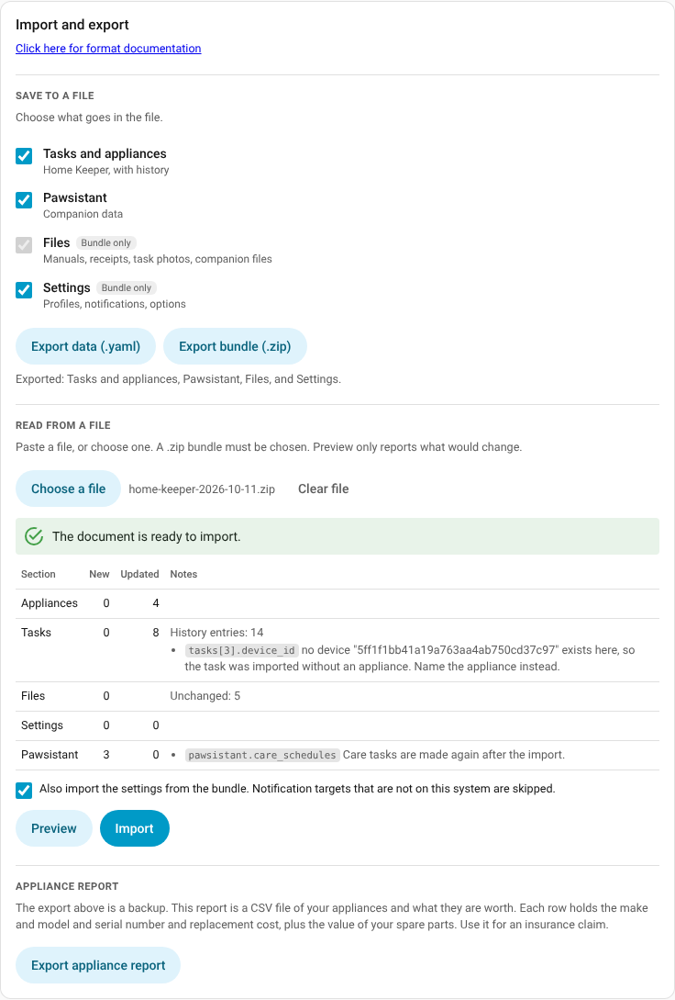
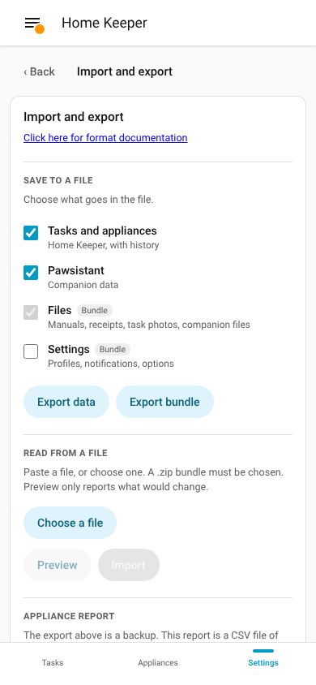
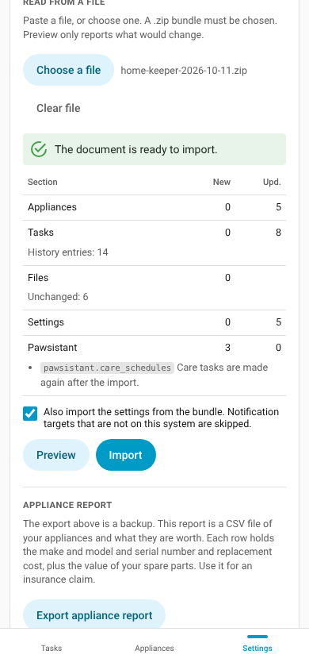

# Import and export

Home Keeper reads and writes its data as one file. Use it to move to another Home
Assistant, or to keep a copy of your own. Use it also to bring in records you keep
in a spreadsheet or an old app.

**Settings → Import and export** has both halves.

**Save to a file** lists the sources of an export, and you clear each source that you
do not want in the file.

| Source | What it holds | Export |
| --- | --- | --- |
| Tasks and appliances | The Home Keeper records, with the history | Data and bundle |
| A companion | The data of a [companion](#companion-data) that supports import and export | Data and bundle |
| Files | The manuals, receipts, task photos and companion files | Bundle only |
| Settings | The profiles, notifications and options | Bundle only. Off by default. |

- **Export data (.yaml)** saves the checked data sources as a YAML file.
- **Export bundle (.zip)** saves a [bundle](#bundles) with the checked sources and the
  files.

After an export, the card names the sources that the file holds. If a companion
export fails, the card names that companion too.

**Read from a file** imports a file.

1. Paste a YAML file into the box, or press **Choose a file**. Choose a bundle, because
   a bundle cannot be pasted.
2. Press **Preview**. Preview only reports what would change. The table has 1 row for
   each section of the file, with the new and the updated records. The Notes column
   shows the problems of each section.
3. If the bundle has settings, select **Also import the settings from the bundle**.
   Then press **Preview** again.
4. Press **Import**. **Import** stays off until a preview of that exact input comes
   back clean.

Both halves are also actions, so a script or an automation can call them:
`home_keeper.export_data` and `home_keeper.import_data`. Both are admin-only. Each
export fires `home_keeper_data_exported`, and each applied import fires
`home_keeper_data_imported`, with a count for each section.

The same card holds the [appliance report](#appliance-report), which answers a
different question. See below.

#### The file

An export is also a worked example. The file it writes is the file import reads, so
one export shows you the whole format:

```yaml
home_keeper:
  format: 1

appliances:
  - external_id: furnace
    name: Furnace
    area: Basement
    manufacturer: Carrier
    model: 59TP6A
    serial_number: "1234-5678"
    cost: 4200
    parts:
      - name: Filter
        part_number: FILXXFCC0021
        type: consumable
        stock: 2
        reorder_at: 1

tasks:
  - external_id: furnace-filter
    name: Replace furnace filter
    appliance: furnace
    interval: 3
    unit: months
    notes: MERV 13 only.
    history:
      - completed_at: "2026-03-04"
        note: Used a MERV 13
        cost: 24.50
      - completed_at: "2025-12-01"
    skips:
      - skipped_at: "2025-09-01"
        note: Away
```

**A record takes the same fields as the action that creates it.** A `tasks` record is
an `add_task` payload. An `appliances` record is an `add_asset` payload. The
[API reference](https://prestomation.github.io/ha-home-keeper/developer/api#actions)
lists every field of both, so it documents the file as well.

The same fields also have a
[JSON Schema](https://prestomation.github.io/ha-home-keeper/schema/home-keeper-1.schema.json).
Every export names it on the first line, so an editor such as Visual Studio Code
checks the file and completes the field names as you type. Home Keeper builds the
schema from the code, so it always matches the version you run.

A record also takes these fields:

| Field | Applies to | What it does |
| --- | --- | --- |
| `external_id` | both | Your own name for the record. See below. |
| `area` | both | An area name. A stated `area_id` wins, if that area is on this Home Assistant. |
| `appliance` | tasks | Which appliance the task belongs to, by `external_id`, name, or id. A stated `device_id` wins, if that device is on this Home Assistant. |
| `history` | tasks | Past completions. Each entry needs `completed_at`, and can add `note`, `cost`, `who`, `photo`. A usage or threshold task can also add `reading`. |
| `skips` | tasks | Past skips. Each entry needs `skipped_at`. |
| `parent_asset_id` | appliances | The appliance this one sits under, by `external_id`, name, or id. List a parent before its children. An appliance cannot sit under itself, through one link or a chain of them. |
| `archived` | appliances | `true` for an archived appliance. On an update, `false` restores an archived appliance. |

A `reading` on any other task is an error. Preview names any entry field it does not
read, then ignores it.

Dates can be a plain `2026-03-04` or a full timestamp. History is read in date order,
whatever order you write it in.

If you write a file by hand, put quotation marks around a text value such as `no`,
`on` or `NO`. Home Keeper reports an error and names the field if you forget. Add
quotation marks and import the file again. Indent with spaces, because YAML does not
accept a tab.

A JSON file also imports, because YAML accepts JSON. Indent it with spaces.

#### How a record finds its match

Import creates a record, or updates the one it already has. It decides which in 3
steps, and stops at the first that matches:

1. **`id`**, Home Keeper's own id. Every export includes it, so re-importing an
   export updates the same records.
2. **`external_id`**, the name you choose. Set this one in a file you write
   yourself, because it makes a second run update the same records instead of making
   a copy of everything. An `external_id` names one record, so 2 records in one file
   cannot share one. If they do, you get an error that names both.
   An `id` also names one record. If you copy a record to make a second one, remove
   the `id` from the copy.
3. **`name`**, an exact match first, then one that ignores case and spaces.

Home Keeper creates a record that matches no stored record. When a name matches 2
records you get an error that names both, because Home Keeper does not guess which one
you meant. To create every record and match no stored record, pass `match: none` to
`home_keeper.import_data`.

An update only changes the fields the file states. Fields it leaves out keep the
value they have.

An update adds the `history` and `skips` of the file to the entries the task has, in
date order. When the task was done after the last date in the file, the task keeps
its last completion and its due date. So an import of the same file again does not
move a task back.

When 2 appliances have the same name, an `appliance` or `parent_asset_id` that
gives this name is an error. Use the `external_id` or the id of the appliance. An
export names such an appliance by its id.

#### Companion data

A companion can add its own data to the export. The companion must support import and
export. Its data goes in a section of its own, with the domain of the companion as the
key:

```yaml
home_keeper:
  format: 1
tasks: []
home_keeper_library:
  format: 1
  version: 1.2.0
  data:
    books:
      - title: Dune
```

Home Keeper writes the section as the companion returns it. On import, Home Keeper
checks every section first, and the companion checks its own section. If 1 section has
an error, the import writes no record in any section. Home Keeper imports its own
records first, then each companion.

A clean preview does not stop all failures. If a companion fails while it writes, its
section gets an error in the report. The Home Keeper records stay written, and the report
has `partial: true`. The panel then says that part of the document was imported. Fix the
cause and import the same file again. The import updates the records that are
already there, so it makes no copies.

The `home_keeper` block names each companion that is not in the file, under
`skipped.companions`:

| Value | Meaning |
| --- | --- |
| `no_import_export` | The companion does not support import and export. |
| `no_service` | The companion has no `export_data` service. |
| `failed` | The export of the companion failed. The log has the reason. |

If a file has a section for a companion that is not installed, the import skips that
section with a warning. To export some companions only, give their domains in
`include`, such as `include: [tasks, home_keeper_library]`.

The import report has a `sections` key. It holds the report of each companion,
keyed by its domain. The `problems` list also holds the companion problems, with the
domain at the start of each path, such as `home_keeper_library.books[0].title`.

#### Bundles

A bundle is a `.zip` file. It holds the YAML file and the data that a YAML file
cannot hold:

- the uploaded appliance documents and part files;
- the task photos;
- the files of each companion;
- the settings: the profiles, the notifications and the other options.

The YAML file is `home_keeper.yaml` at the root of the zip file. A `files` section in it
lists each uploaded file and its record. In the panel, press **Export bundle (.zip)** in
Settings → Import and export. An action writes a bundle with `kind: bundle`:

```yaml
action: home_keeper.export_data
data:
  kind: bundle
```

The action writes the file to the `home_keeper_exports` folder in your configuration
folder, as `home-keeper-YYYY-MM-DD.zip`. A second export on the same day replaces that
file. The response holds the `path` and the `size` of the file.

To import a bundle, choose it in the panel, or give its file name to the action:

```yaml
action: home_keeper.import_data
data:
  bundle: home-keeper-2026-10-11.zip
  dry_run: true
```

The import adds a file to a record only if the record does not have it. A bad or a
missing file gives a warning, and the import continues without it.

#### Settings

An import reads the settings only if you set `include_settings: true`. In the panel,
select **Also import the settings from the bundle**. Else the preview names each
settings section that it skips.

- A profile or a notification updates the one with the same id, then the one with the
  same name. Any other profile or notification is added. The import never deletes a
  profile or a notification.
- A notification that names a profile follows that profile. This is also true when the
  profile matches by name and keeps the id that it has on this install.
- Home Keeper warns about a notify target or a to-do list that this Home Assistant
  does not have. Fix them in Settings after the import.
- A profile filter holds the ids of areas, labels and devices. Home Keeper imports each id
  and warns about the ids that this Home Assistant does not have. Fix the filter of the
  profile in Settings after the import.
- Home Keeper sends only to a mobile app or to a persistent notification. The import
  leaves out each other notify target and warns about it.
- An option value of the wrong type, such as text for a list, is left out with a warning.

A YAML export holds the settings only if `include` names `settings`.

#### Import/Export Limitations

The file does not hold every record. What an export leaves out is listed in its own
`home_keeper` block, and the preview names every field that Home Keeper did not read
on the way back in.

- **Uploaded manuals, receipts and photos in a YAML file.** A text file has no room
  for a picture or a PDF. Use a [bundle](#bundles) to keep them. A link to a document
  is only text, so it stays.
- **Tasks that another part of Home Keeper owns**, such as a wear part's replacement
  reminder, a buy reminder, a problem-sensor mirror, or a declarative companion task.
  Home Keeper builds these again from the appliance and its parts, which the file does
  include.
  A counted wear item keeps its count. The count is on the part, because the 2
  tasks that use it are not in the file.
- **Tasks created by companions.**
- **The link from a task to a consumable.** The task is in the file, but its link is
  not. The `home_keeper` block counts these links. Link the tasks again after an
  import.
- **Appliances that a companion manages**, with their stock counts. The companion
  builds the appliance again after an import. Enter the counts again.
- **Declarative companions.** These stay in Home Keeper.
- **Records that are not in the file.** An import never deletes a record.

#### How big a file can be

The panel and the service each hold their own limit.

| Path | Limit | Reason |
| --- | --- | --- |
| Paste a file in the panel | 4 MB | Home Assistant's own limit on a websocket message. Home Keeper cannot raise it. A larger YAML file goes in through **Choose a file**. |
| Choose a YAML file in the panel, or call the `home_keeper.import_data` service | 8 MB | Home Keeper's own limit on a YAML document. |
| Upload or import a bundle | 500 MB | Home Keeper's limit on the files in a bundle, when they are extracted. |

A YAML file over 8 MB must go in as several files. Each of `tasks` and `appliances`
also holds at most 2000 records. A bundle holds at most 20000 files.
Home Assistant stops an upload as soon as it passes its limit.

#### Ask an AI agent to write one

The format is meant to be easy to generate. Export what you have, then give the file
to an AI agent with whatever holds your records now, such as a photo of a spreadsheet
or a page of notes. Ask for the same shape back as one YAML document,
with an `external_id` on every record. Paste the answer into the Import
box and press **Preview** first: it checks every record and reports each problem with
the path to it, so you can fix the file and try again. Nothing is written until the
preview is clean.

#### Appliance report

The export above is a backup. The **appliance report** is a report, and the 2
answer different questions.

Press **Export appliance report**, at the foot of the same card, to save a CSV
file of your appliances and what they are worth. Each row holds the name and the
area and the make and model and serial number and replacement cost. It also holds
the value of the spare parts you hold for that appliance, which is each part's
cost multiplied by its stock. A Details column holds the custom fields. The last
row totals the replacement costs and the spares.

A spreadsheet opens the file, so use it for an insurance claim or for your own
records. Column headings are in your Home Assistant language.

The report is also an action, `home_keeper.export_appliance_report`, which returns
the same rows under a `report` key and the CSV under a `csv` key. The action is
admin-only, because the report holds every serial number and purchase cost.

**The report holds no field the export leaves out.** An export of your appliances
holds the make and model and serial number and cost and the stock of every part.
It also holds every custom field, as a label and a value you can read.

What the report adds is the arithmetic, because it multiplies and totals those
values, and a shape made to read. The Details column is part of that shape: it
prints your custom fields as `label: value; label: value` in one cell, because a
spreadsheet column cannot hold a list. The export keeps each field separate, which
is what an import needs to read them back.

So use the export to move your data, and the report to state what you own and what
it is worth.






