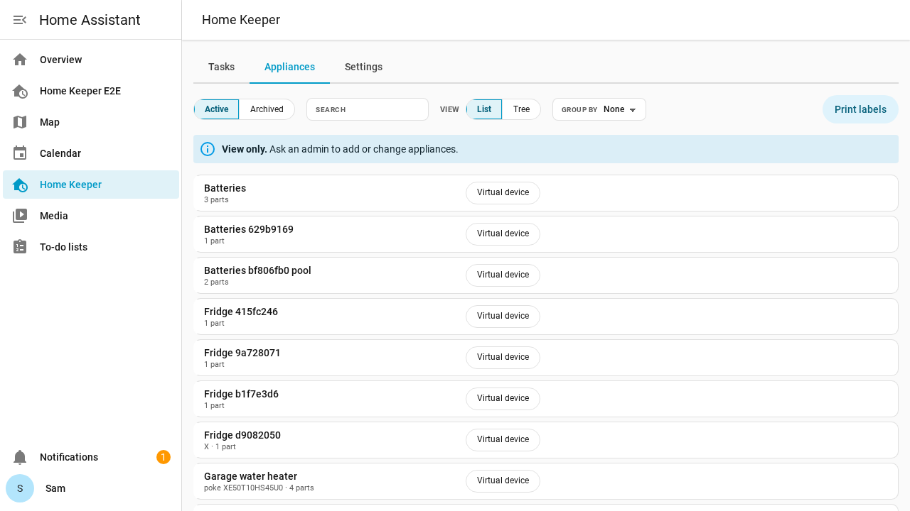
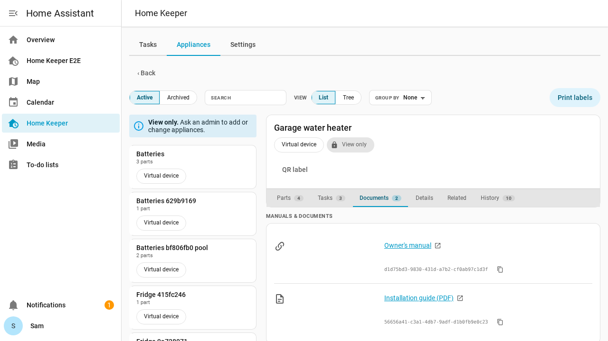
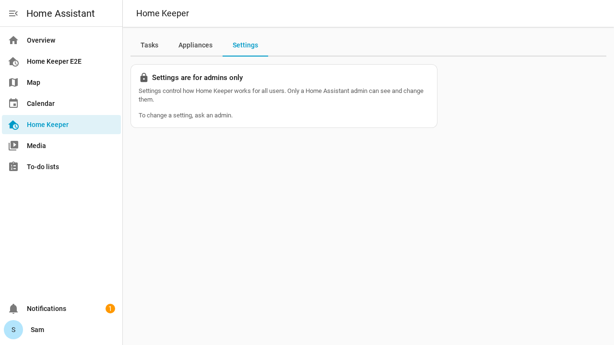
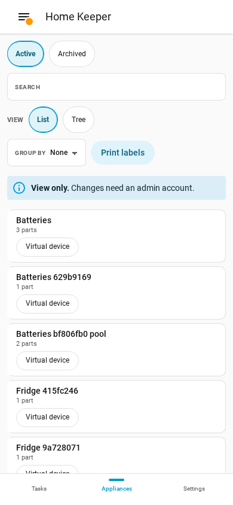

# Household users

Home Assistant has 2 kinds of user: admins and users who are not admins. Home Keeper uses
the same split. Any user can open the Home Keeper panel. Only an admin can change the
appliances and the settings.

Give a household member a user account that is not an admin. They can then use the panel
to do their tasks and to read the appliance manuals, but they cannot change Home Assistant.

## What a user who is not an admin can do

On the **Tasks** tab, the user can do all the task actions that an admin can do:

- Add, edit and delete tasks.
- Complete, snooze and skip tasks, and edit the completion history.
- Add and remove task photos.

On the **Appliances** tab, the user can read all appliance data:

- The list of appliances, active and archived.
- Each appliance with its parts, stock, documents, manuals, links, details and history.
- Open a manual or a document.
- Print QR code labels.

A note at the top of the list tells the user that the tab is view only.

An appliance page shows a **View only** chip, and has no **Edit**, **Archive** or
**Delete** button.

## What only an admin can do

- Add, edit, archive and delete appliances, parts and documents.
- Change the stock count of a part in the panel.
- Change the settings, the profiles and the notifications.
- Add and edit companions, and use the tabs of a companion integration.
- Export and import data, and export the appliance report.

The **Settings** tab stays in the panel. For a user who is not an admin, it shows only a
note that the settings are for admins.

On a phone, the panel shows the same notes.

## Privacy

Any signed-in user can read all appliance data. This includes purchase costs, serial
numbers and warranty dates.

Some accounts, such as a guest account, must not see this data. Do not give those
accounts access to Home Assistant. See
[the security model](../../SECURITY.md) for the details.
