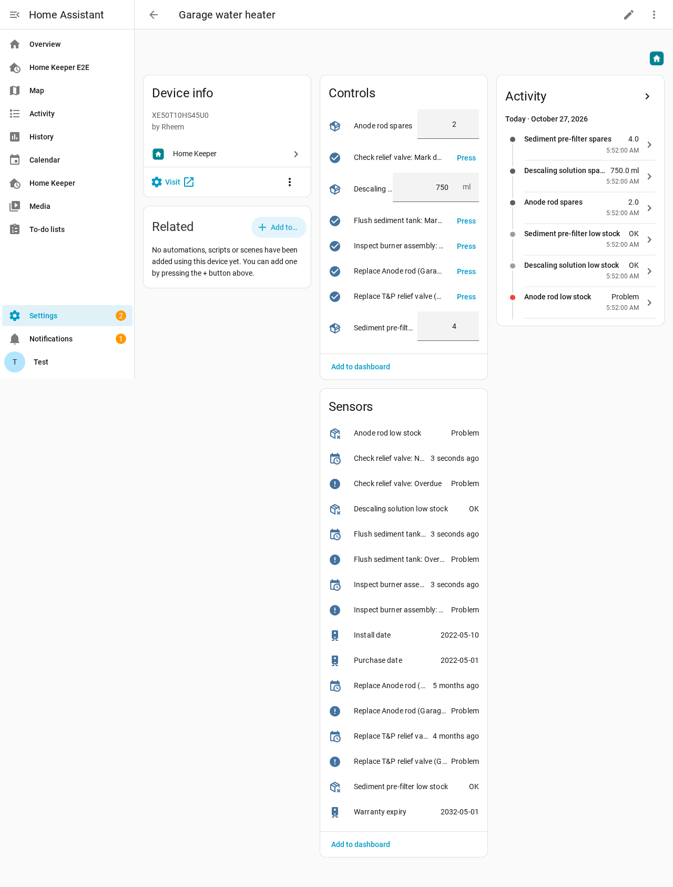
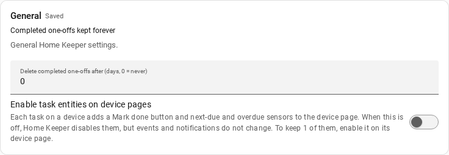
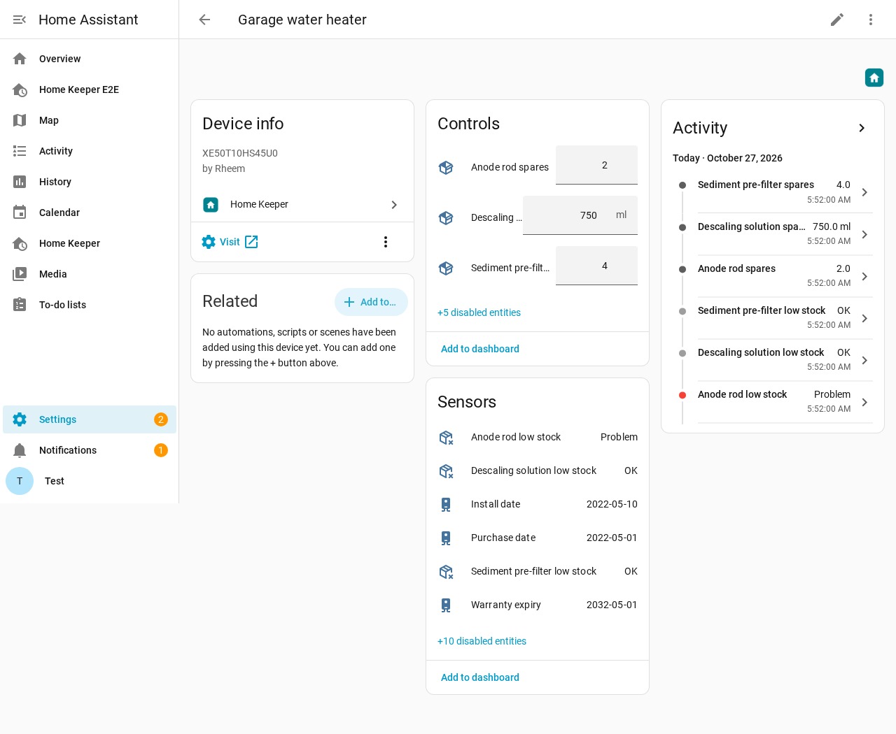
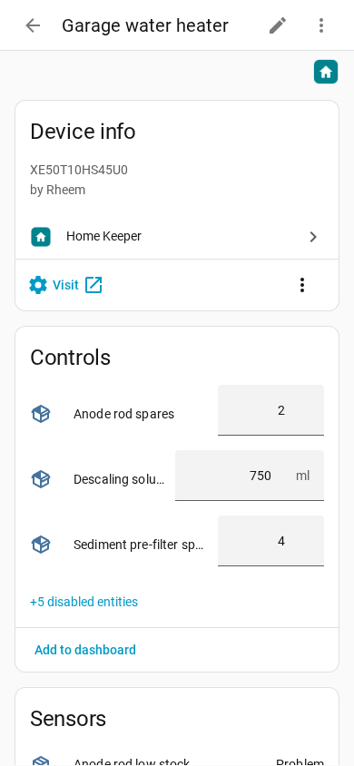

# Task entities on device pages

A task that you attach to a device adds entities to the page of that device:

| Entity | What it shows or does |
|---|---|
| **Mark done** button | A press completes the task. |
| **Next due** sensor | The date and time when the task is due. |
| **Overdue** binary sensor | On when the task is overdue. Its attributes give `due_soon` and `next_due`. |

Use them on a dashboard, or as the trigger or condition of an automation. A task that
only a tag scan or its sensor can complete has no **Mark done** button.



## Turn the entities off

Many users do not use these entities. The panel, the
[notifications](../views/notifications.md) and the to-do list do the same work. With many
tasks on devices, the entities fill the device pages.

To turn them off, go to **Settings**, open the **General** card, and turn off
**Enable task entities on device pages**. You must be an administrator.



When the switch is off:

- Home Keeper disables each task entity in the Home Assistant entity registry. The device
  page shows them under **+N disabled entities**.
- A new task on a device gets disabled entities.
- The entity ids stay. When you turn the switch on again, your dashboards and automations
  find the same entities.
- [Events](../automation/events.md), the logbook rows on the device page, the task count
  sensors and the notifications keep working. They do not use these entities.





## Keep only some entities

Turn the switch off, then enable the entities that you use. On the device page, click
**+N disabled entities**, open the entity, and turn on **Enabled** in its settings. After
about 30 seconds Home Assistant adds the entity again, and Home Keeper leaves it enabled
while the switch stays off.

## Turn the entities on again

Turn the switch on. Home Keeper enables each entity that it disabled. An entity that you
disabled yourself stays disabled. Home Assistant adds the entities after about 30
seconds.

The switch is also a field of the `home_keeper.set_options` service:

```yaml
action: home_keeper.set_options
data:
  task_device_entities: false
```
